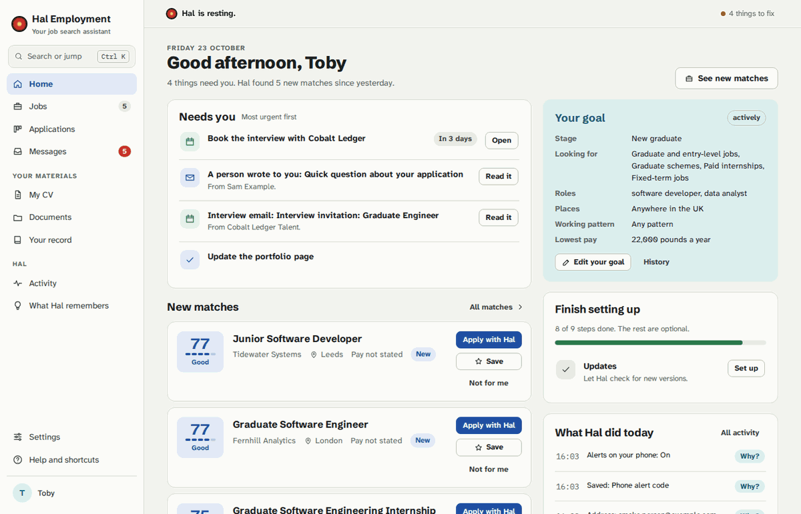
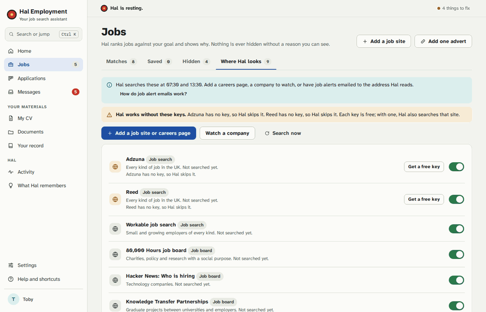
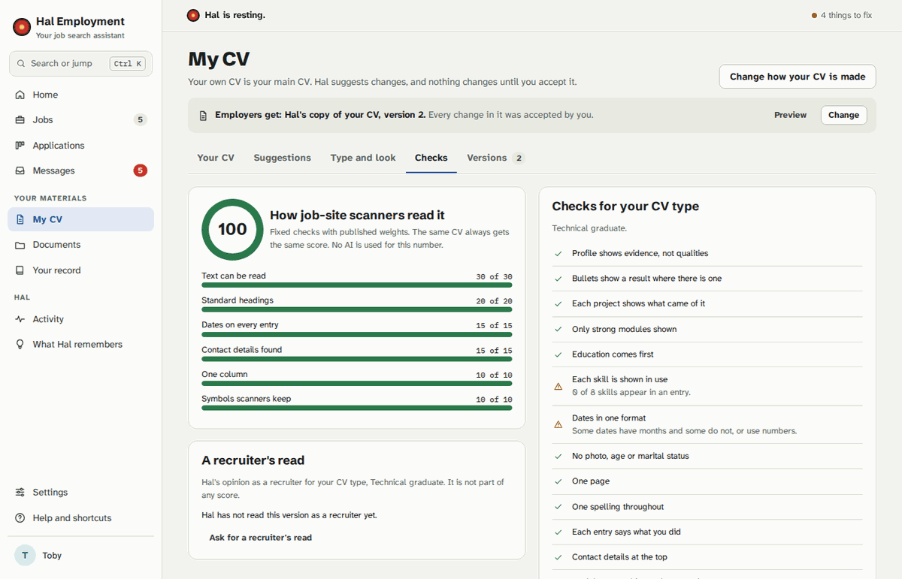
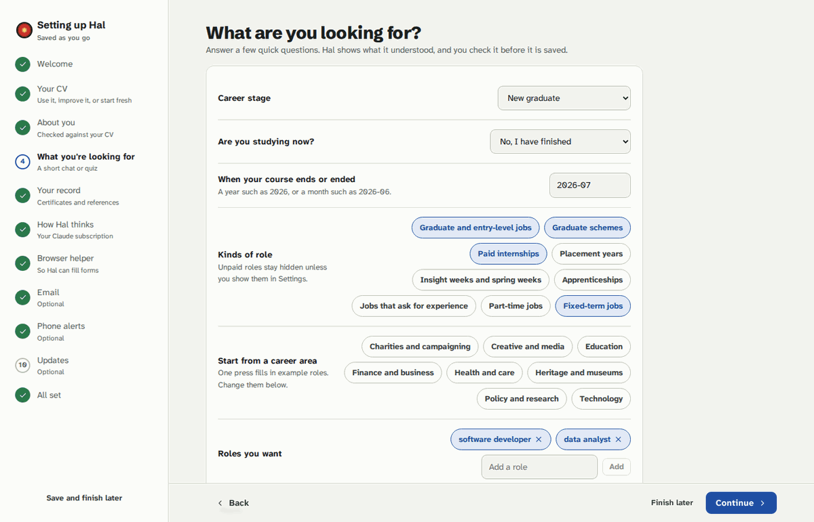
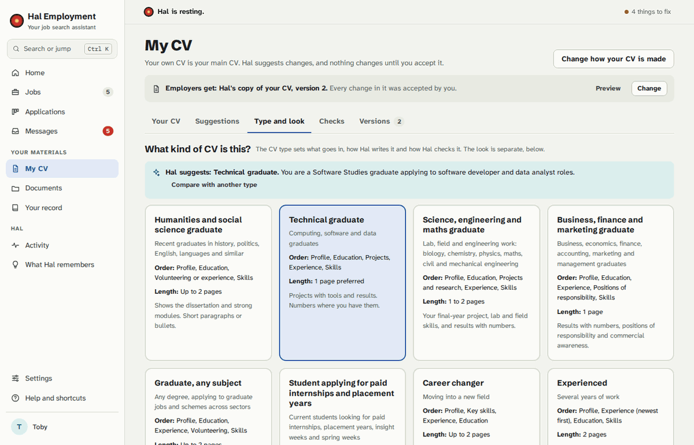

# Hal Employment

**A job search assistant that runs on your own computer: it finds UK graduate jobs and internships that
suit you, says why each one fits, writes the CV and cover letter, and fills in the employer's form in your
browser. Then it stops, because Hal never presses Submit.**



Python 3.11+ (standard-library HTTP server, SQLite), a Preact and htm front end with no build step,
Playwright and a Manifest V3 browser extension for forms, and a local model through Ollama, with your own
Claude subscription as the fallback. Windows 10 and 11, and Linux.

> **The rule Hal obeys:** it finds, writes and fills in, and you check and send. Hal never presses Submit,
> Send or a final Apply, and it never sends anything to an employer. The tests fill practice forms whose
> servers count every post, and the count must stay at zero.

---

## Why it exists

I built this during my own graduate job search. Most of applying is repetition: the same searches on a
dozen boards, the same CV adjusted again, the same name and address typed into yet another applicant
tracking system. I wanted a tool that did the repetitive parts and left every decision with me.

It started as a command-line tool that only I could use. It grew into an app when I wanted to hand it to
people who would never open a terminal, and that changed what mattered. Nothing about one person could be
built in, so it scores jobs against each person's own goal and works for any career. It had to install on
Windows with a double-click and no admin rights. And it had to be impossible for it to send an application
by itself.

## What it does

- **Finds jobs that fit.** Hal searches UK job boards, employers' careers pages (Greenhouse, Lever, Ashby,
  Workable, SmartRecruiters, Recruitee, Personio) and the job alert emails you already get. It covers
  graduate jobs and schemes, paid internships, placement years, insight weeks and apprenticeships, and
  scores each job against your own goal, showing every point.
- **Explains everything.** Every score, hidden job, suggestion and form answer has a "Why?". Activity keeps
  everything Hal did and why, with Undo.
- **Writes the documents.** A CV adjusted for each job, a cover letter and answers to the form's questions,
  in your CV type's style. Hal never adds a number, date or qualification it cannot find in your CV or
  record; it leaves a gap such as `[how many?]` for you to fill.
- **Fills in the form, then hands over.** A browser helper fills the form in your own browser, where you
  are already signed in. Each answer is marked "Fine" or "Check this", and on the last page Hal hands the
  form to you.
- **Keeps your private answers private.** Answers to equality and adjustment questions are used only on the
  form you approved, never sent to the AI, never logged and never shown again.



## How it is built

**Local first, with a fallback.** Hal needs an AI to read adverts and write. It runs a local model through
Ollama, or any local server that speaks the OpenAI format. Not everyone has a graphics card that can run a
model, so the fallback is the person's own Claude Pro or Max subscription through Claude Code, which Hal
installs and signs in to without an admin prompt. Which AI sees your data is your choice: it never changes
by itself, and "Never use online AI" keeps everything on the computer.

**Never Submit is enforced in code, not in a prompt.** Every press in a form goes through one guard that
refuses Submit, Send and Finish controls, and a script in the page itself blocks the form's own send
methods while Hal works. The browser helper mirrors the same guard.

**Private answers have two locks.** One classifier keeps private questions out of every AI request, and a
guard in front of every AI call refuses any prompt that holds a saved private answer. The tests push a
canary value through each path.

**Every slow job is a persisted action** with steps, Stop, a reason and an Activity row, and it survives a
restart. Areas plug in by module name (routes, settings, actions, health checks, Home cards), so a new area
edits no core file. [docs/dev/architecture.md](docs/dev/architecture.md) has the details.

**It runs on Windows and Linux.** CI runs the full suite, browser tests included, on Linux with Python 3.11
and 3.13 and on Windows with Python 3.13. A platform layer holds what differs between the two (windows,
pop-ups, start at login, finding browsers), and tests drive it with fakes.



## Part of the Hal ecosystem

Hal Employment is one part of Hal, my local-first desktop assistant: a local model that you talk to in the
terminal, by voice or from your phone, with extensions for the calendar, tasks, notes and more. Hal
Employment works on its own; next to Hal, the hal-jobs extension gives Hal's brain the job search (the
queue, to-dos and application status), and with "Use my Hal setup" on, Hal Employment writes its pipeline
note into the Hal vault, speaks urgent alerts in Hal's voice, offers Hal's local models as AI choices and
can pause with `hal off`.

Two AI modes, chosen with little setup. On its own (the default when Hal is not installed) Hal Employment
uses Claude Code or a model on this computer. With Hal, it uses Hal's local model through Hal's gateway
when the gateway answers (or after `python -m jobhunt settings set ai.provider hal`), and never falls back
to Claude unless you pick Claude yourself. Settings shows which mode is in force. See
[use the helper with Hal](docs/howto/use-the-helper-with-hal.md) and
[use the helper on its own](docs/howto/use-the-helper-on-its-own.md).

- [Hal](https://github.com/NotEoin/Hal): the local assistant and its long-term memory.
- [hal-voice](https://github.com/NotEoin/hal-voice): talk to Hal out loud.
- hal-ecosystem (the installer and map), hal-hub (finds extensions and runs their tools) and hal-jobs: the
  ecosystem repositories are published together.

## Install

You need Windows 10 (1809 or newer) or 11, or a 64-bit Linux desktop. No admin rights are needed.

- **Windows:** download `scripts/install/install-hal-windows.cmd` and double-click it
  ([steps](docs/howto/install-on-windows.md)).
- **Linux:** download `scripts/install/install-hal-linux.sh` and run it with bash
  ([steps](docs/howto/install-on-linux.md)).

The install file gets its own copies of uv, Python and Git (each pinned by SHA-256), clones Hal, makes the
shortcuts and opens the setup guide. Updates come from this repository and install only when you press
**Update Hal** ([how](docs/howto/update-hal.md)).

To run Hal from your own clone, see [CONTRIBUTING.md](CONTRIBUTING.md).

## Use

Open **Hal Employment** from the Start menu or your applications menu. The setup guide takes about 30
minutes: your CV, what you are looking for, which AI to use and the browser helper.
[docs/user/getting-started.md](docs/user/getting-started.md) walks through it and a normal day.



From a clone:

```sh
uv run python -m jobhunt serve --open   # run the server in this terminal and open a signed-in window
uv run python -m jobhunt open           # open a signed-in window, starting Hal in the background first
uv run python -m jobhunt --help         # every command
```

Hal listens only on `127.0.0.1`. To use it from a laptop while it runs on a desktop, see
[docs/howto/use-hal-from-another-computer.md](docs/howto/use-hal-from-another-computer.md).

## Configuration

Everything is in Settings, grouped as in the setup guide, with search and Reset; every change is kept in
Activity with Undo. The choices that matter most:

| Setting | Choices | Default |
| --- | --- | --- |
| How Hal thinks | Hal's local model (the gateway), This computer (Ollama), Another local server (OpenAI format), Claude subscription | Hal's local model when Hal's gateway answers; else This computer on Linux when Ollama answers, else Claude |
| Never use online AI | On or off | Off |
| What you're looking for | Career stage, kinds of role, roles, places, working pattern, lowest pay | Set in the setup guide |
| Browser Hal fills forms in | Opera, Google Chrome, Microsoft Edge, Brave or Vivaldi | The first one Hal finds |
| Press Submit for you | Never (it cannot be changed) | Never |
| Email and phone alerts | A Gmail inbox read with an app password; ntfy alerts | Off |

Your data lives in your own user folders, never in the program folder, so an update never touches it.
[docs/user/privacy.md](docs/user/privacy.md) lists the folders, what is stored and what leaves the
computer. For developers, `HAL_EMPLOYMENT_HOME` points Hal at another data folder and `HAL_EMPLOYMENT_PORT`
changes the port (8737 by default).



## Development

```sh
uv sync --frozen --extra browser --extra documents   # Linux; on Windows leave out --extra documents
scripts/dev/checkpoint.sh --quick                    # before each commit: the staged lines' checks, then the tests
scripts/dev/checkpoint.sh                            # every check, browser tests on
```

Tests never touch real data: with `HAL_TEST_MODE=1` and no `HAL_EMPLOYMENT_HOME`, every data folder
refuses to open, and everything outside Hal (job sites, email, the AI, GitHub, SSH) is a fake.
[docs/dev/testing.md](docs/dev/testing.md) explains the checks, and [CONTRIBUTING.md](CONTRIBUTING.md) what
a change needs. Every document is listed in [docs/README.md](docs/README.md).

## Licence

MIT, see [LICENSE](LICENSE). Third-party parts keep their own licences: see
[THIRD_PARTY_NOTICES.md](THIRD_PARTY_NOTICES.md). Security problems: [SECURITY.md](SECURITY.md).
